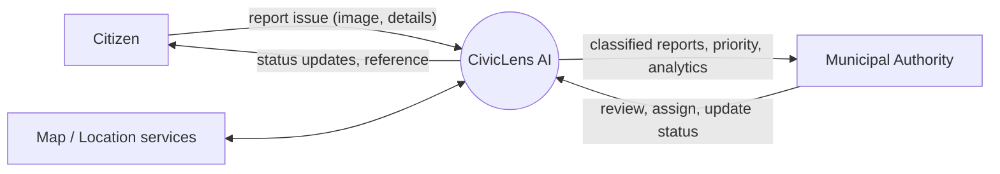
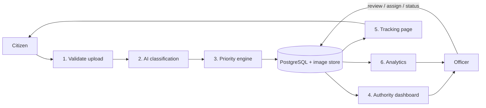
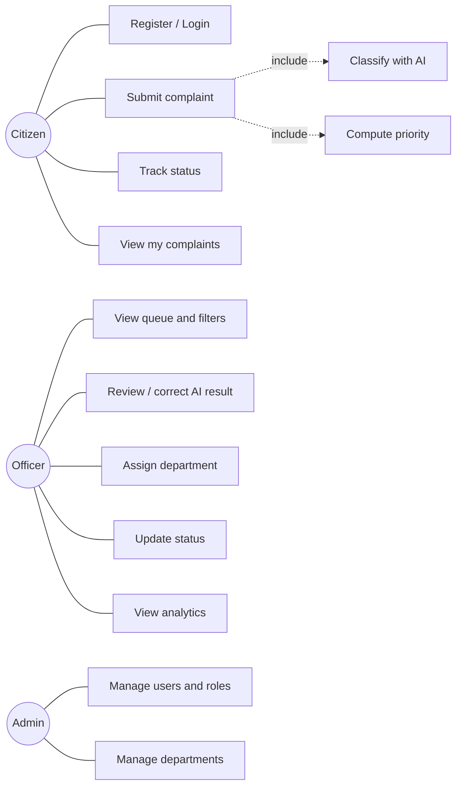
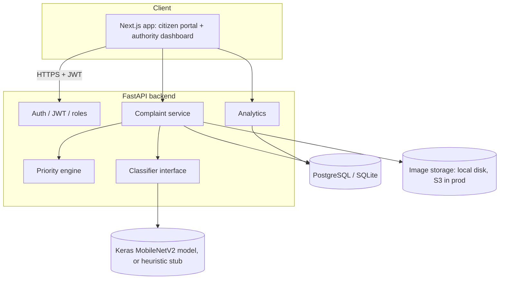
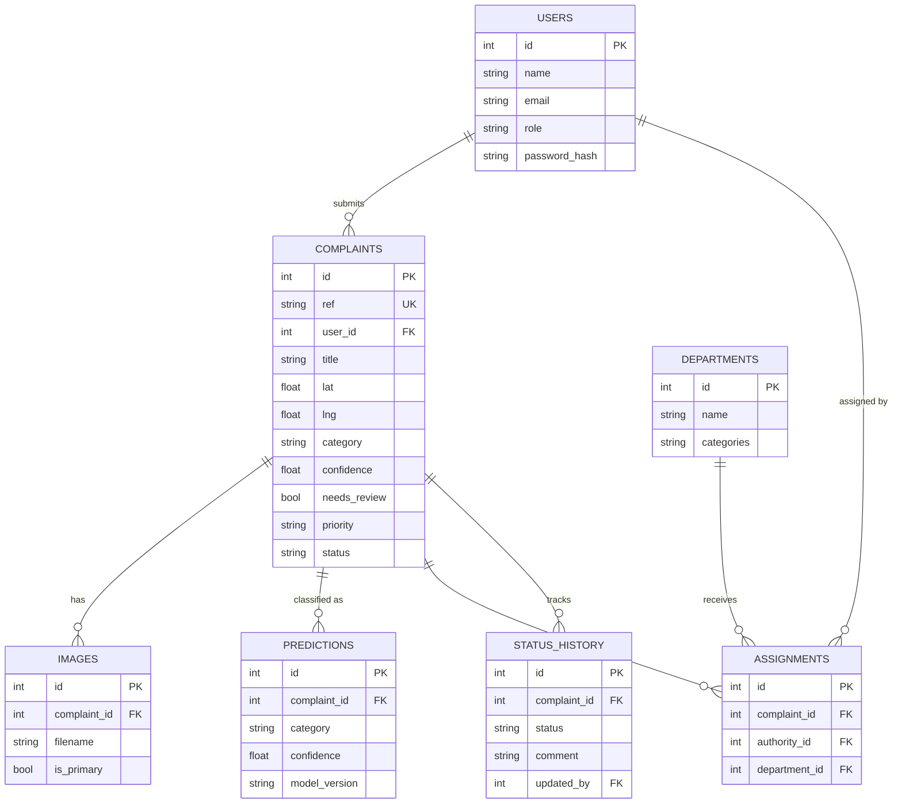

# CivicLens AI: Design Diagrams (Mermaid)

Render in GitHub, VS Code (Mermaid preview) or https://mermaid.live.

## 1. Context diagram

## 2. Data-flow diagram (level 0)

## 3. Use-case diagram

## 4. Architecture diagram

## 5. ER diagram

